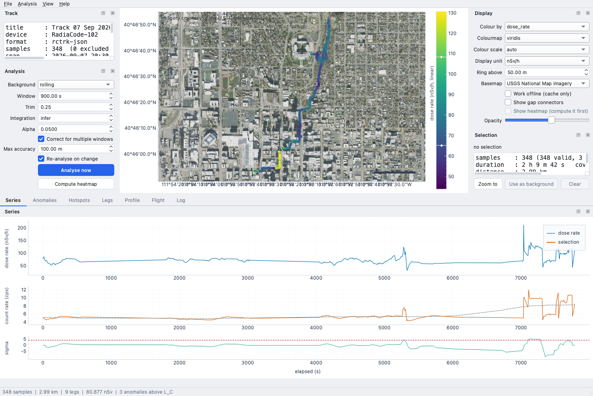
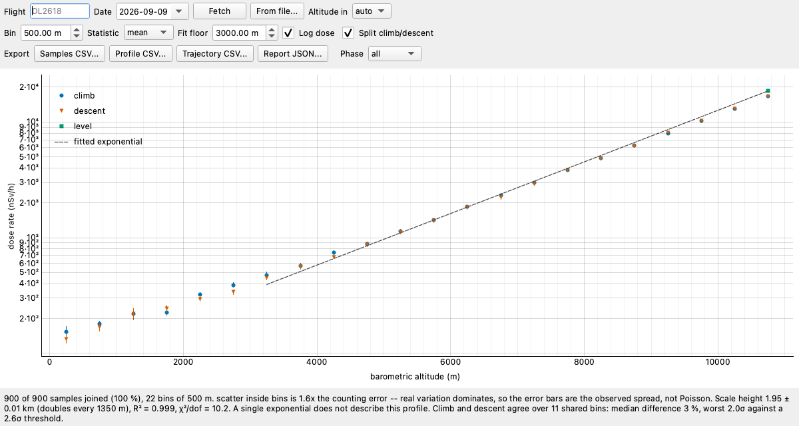
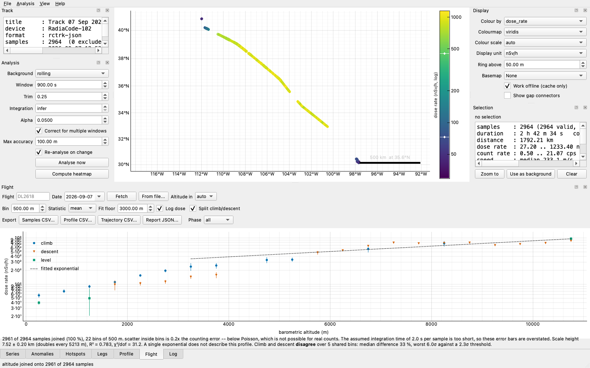

# Radiacode Track Analyzer

Analysis of GPS radiation tracks (`.rctrk`) from RadiaCode 100-series handheld
CsI(Tl) scintillation detectors. Built to one principle: **the honest answer is
usually a detection limit, not a detection**, so the program is designed to
make it hard to claim a source that is not there.

The primary use is **characterising ambient dose along a walk** — mapping how
background varies with geology, building materials and shelter — rather than
hunting a hidden source. The statistics still matter for that: they are what
separates "that reading by the granite wall really is elevated" from "that is
counting noise", which by eye are indistinguishable.



*A 2 h walk in Salt Lake City: 348 samples, 2.99 km, background 0.072 µSv/h,
with one spot seen elevated on two separate passes.*

## Install

```sh
conda env create -f environment.yml
conda activate rcta
pip install -e ".[gui,dev]"
```

`python -m pytest` runs the suite and `ruff check src tests tools` the lint;
CI runs both.

The analysis core needs only numpy and scipy. PySide6 and pyqtgraph are an
optional `gui` extra, so the core installs and runs headless. On Windows it
also pulls in `tzdata`, because the OS ships no zone database and `--date` is
a calendar day at the departure airport; elsewhere the system's own is used.

## Use

```sh
rcta                                  # the desktop application
rcta sample-data/Track*.rctrk         # opening a file directly

rcta-cli info    sample-data/Track*.rctrk
rcta-cli analyze sample-data/Track*.rctrk --json report.json
rcta-cli analyze surveys/*.rctrk --fail-on-detection  # exit 5 if anything is found
rcta-cli export  "sample-data/Track 07 Sep 2026 14-30-57.rctrk" \
    --format geojson -o walk.geojson
rcta-cli grid    "sample-data/Track 07 Sep 2026 14-30-57.rctrk" -o walk.asc

# a trajectory from disk: no account, no network, nothing to look up
rcta-cli flight  "sample-data/Track 07 Sep 2026 07-53-59.rctrk" \
    --trajectory sample-data/DL2618-2026-09-07-synthetic-trajectory.json

# or look the flight up, with the date from the boarding pass
rcta-cli flight  TRACK.rctrk --flight DL2618 --date 2026-09-07
```

### Moving around the window

The bottom of the window is one tabbed stack — Series, Anomalies, Hotspots,
Legs, Dwells, Profile, Flight, Log — so only one of them competes for the vertical
space the map wants. **Ctrl+1** through **Ctrl+8** switch straight to a panel
in that order, reopening it if it was closed, and **Ctrl+PgDown** /
**Ctrl+PgUp** (or **Ctrl+]** / **Ctrl+[**) step along the stack. The same
actions are under *View → Panels* with their keys shown; the tab bar above
the panel does the job with the mouse. *File → Save session* writes the track, every analysis
setting, the reference span, the selection and the display choices to a
`.rcta.json` file that *Open session* rebuilds exactly, for a figure you need
to reproduce. *View → Series in clock time* labels
the series in UTC instead of elapsed seconds. **Ctrl+0** zooms the map to the
whole track, **Esc** clears the selection, and double-clicking a row in the
Anomalies, Hotspots or Legs table zooms to it.

## Walking surveys: what the tool corrects for you

On foot at 1.4 m/s with 2 s logging, each step is **2.8 m** while a good
handheld fix is **8 m**. The measurement is therefore mostly noise, and three
things follow that the obvious implementation gets wrong:

- **Distance.** Raw summed GPS distance overstates a walk by **5.2×** at 8 m
  accuracy (measured against known truth; still 2.1× at 3 m). Positions are
  smoothed with an automatically chosen window before distance and speed are
  measured, which lands within 3 % of truth across 3–20 m accuracy, on both
  straight and sharply cornered routes. The window is reported, along with how
  much of the raw path was jitter. Vehicle and flight tracks are detected as
  needing no correction and are left byte-identical.
- **Speed.** Inherits the same error — a 1.4 m/s walk reads as 7 m/s uncorrected.
- **GPS glitches.** A 100 m jump in 2 s is 50 m/s: nonsense on foot, but far
  under any absolute ceiling. Outliers are the union of a hard ceiling and a
  robust bound on *this* track's own speed, evaluated on unsmoothed fixes.

**Stop-and-measure dwells.** Wherever the detector stood still for two
minutes or more, the samples are added into one long count and tested
against the background on their own, with a Bonferroni correction across
the dwells. A dwell is the most sensitive measurement on a walk: on the
bundled one, 80 s of live time reaches 12 nSv/h, against 64 nSv/h for a
single sample. Dwells appear in the `analyze` summary and the JSON report.

At walking scale the interpolated heatmap also becomes genuinely useful. On
the bundled walk it keeps its 50 m bandwidth and 25 % of the bounding box is
supported: every cell within 100 m of the route, with the rest left blank
rather than extrapolated. On the continental transect the bandwidth has to be
raised to 6.4 km to be resolvable at all, and only 2 % of the box is
supported. *Analysis → Compute heatmap* (**Ctrl+Shift+H**) draws it under the
points on their own colour scale; *File → Export heatmap grid* and
`rcta-cli grid` write it as an ESRI ASCII grid with its `.prj`, blank cells
as NODATA.

## Worked example: a null result

This is the whole point of the tool, so it is the first example. Running
`rcta-cli analyze` on the bundled 2 h 42 m flight from Austin to Utah:

```
-- detections --------------------------------------------------------
no anomalies above L_C at 4.57 sigma

minimum detectable dose rate, by window:
    1 samples (     2 s):  1159.97 nSv/h
   64 samples (   128 s):   132.56 nSv/h

1 candidate(s) excluded by flags:
     506 s  31.04148N  98.49739W  net   +1.59 cps (+81.51 nSv/h)    8.48 sigma
       [trend, poor-gps, gps-transition, gap-adjacent]
```

There is nothing localised in this track. The one feature above threshold is
the climb-out — a real twenty-minute rise in cosmic dose rate with altitude,
correctly flagged as a trend rather than reported as a hotspot. **The MDA table
is the result**: over a two-second sample this detector could not have seen
anything below about 1160 nSv/h, and over two minutes about 133.

## Flights: importing the altitude the format does not have

The file carries no altitude, and on an airborne track that is the whole
problem — altitude is the only variable that explains the count rate. So
`rcta-cli flight`, and the GUI's **Flight** dock, take a flight number and a
date, fetch the trajectory, and plot dose rate against altitude.



*A profile with a known answer: 900 samples built from a 2000 m scale height,
recovered as 1.95 ± 0.01 km. A constant scale height is a straight line on the
log ordinate, so the fit and the picture check each other. Note the bins below
3 km bending away from it — that is terrestrial gamma, which does not vary with
altitude, and it is why the fit has a floor.*

The ordinate is logarithmic, and climb and descent are separate series rather
than pooled, because the two are independent traverses of the same atmosphere
hours apart and how far apart they land is the honest error bar:

```
scale height : 1.95 +- 0.01 km e-folding
             : dose rate doubles every 1350 m of climb
goodness     : R2 = 0.999, chi2/dof = 10.2

climb vs descent : consistent over 11 shared bin(s)
  worst bin 1.99 sigma against a 2.84 sigma threshold (two-sided, Bonferroni over 11 bins)
```

On the bundled sample the same command reaches the opposite conclusion, and
that is the point:



*The bundled flight joined to its bundled trajectory. The position match passes
— median residual 0.10 km over 2,484 samples — and 2,961 of 2,964 samples get an
altitude. But the climb and the descent disagree by 33 %, 6.0 σ against a
2.6 σ threshold, χ²/dof = 31.2, and the control says so instead of quoting a
tidy scale height. This trajectory's altitude axis is fabricated, which
inflates the disagreement; on the real fetched trajectory it is 12.5 % and
4.07 σ, and still there. See `docs/FLIGHT.md`.*

**The join is validated against position, not trusted.** A flight number is a
string a human typed, and any trajectory joins onto any track by timestamp: get
the flight, the day or the leg wrong and the result is a smooth, plausible,
entirely fictional curve with no symptom. So the trajectory's own positions are
compared with the fixes the detector recorded, and a disagreement past a
tolerance is a **refusal** rather than a plot — exit code 4, distinct from 3 for
"could not fetch". A clock offset looks exactly like the wrong flight at 233 m/s,
so the offset that would minimise the residual is always measured and reported,
and never applied on its own initiative.

**Climb versus descent is the honest error bar.** The aircraft crosses the same
altitudes twice, hours apart and a continent away, so whether the two agree
bounds how much of the profile is altitude and how much is geomagnetic latitude
or a join that is wrong at one end. It is reported beside every fit.

Historical trajectories need free [OpenSky](https://opensky-network.org)
credentials — anonymous callers are refused with `HTTP 403`, and no keyless API
serves a flight that has landed. The lookup is keyed by the **departure
airport**, which the track supplies itself: its first fix is on the apron of
the airport it left from, resolved against a bundled table of the 4,053
airports with scheduled service (a trimmed extract of
[OurAirports](https://ourairports.com), public domain, with IANA timezones from
[OpenFlights](https://openflights.org/data), ODbL). `--departure ICAO`
overrides it for a track that starts away from the terminal. Keying the search
by time instead cannot find a flight longer than two hours at all — see Design
notes.

That airport's timezone also decides what `--date` means: it is the date on
the **boarding pass**, not the UTC one. For an evening departure those are
different days, and getting it wrong does not return nothing — it returns
yesterday's flight under the same number. Design notes has the case that
prompted it. Only `--date` is local; everything printed stays UTC.

A **local trajectory file needs nothing**, works offline, and is a first-class
mode rather than an error state:

```sh
rcta-cli flight TRACK.rctrk --trajectory exported-from-anywhere.csv
```

When a fetch does fail, the reason and an actionable next step are reported
together — in the CLI under the failure, and in the Flight dock's caption with
the sign-up link live. "No credentials" and "a credentials file I could not
read" are different messages, because they need different fixes. **Clear
cache** in the Flight dock discards cached responses, asking first and naming
the size: a settled flight is cached for ever because its history cannot
change, so clearing it means paying those metered requests again.

**The plot is not the deliverable.** The Flight dock's Export row writes the
per-sample data (`--samples-csv`), the binned profile (`--csv`), the trajectory
(`--save-trajectory`) and the full JSON report, scoped to a phase of flight if
you want the climb and the descent as separate files. The per-sample CSV carries
the estimated counts and the assumed integration time on every row, so Poisson
errors can be recomputed rather than trusted, and nothing has a comment line or
a preamble, because these are files for other software to open.

Altitude units are the trap worth knowing about: flight trackers export feet,
researchers export metres, the ratio is 3.28, and it lands entirely on the
x-axis of the one plot the feature exists to draw. A column that names its unit
is believed, a bare one above 20 000 must be feet, and a genuinely ambiguous one
is read as metres *with a warning naming the override* rather than guessed at.
See `docs/FLIGHT.md`.

## Design notes

Each of these is a decision that a more obvious implementation gets wrong, and
each is pinned by a regression test.

**The background estimator defines what counts as an anomaly.** It is reported
with every result for that reason. The default is a *symmetrically trimmed
mean* of a rolling time window, not a low quantile: the 0.25 quantile of an
18 cps Poisson background sits 2.0 cps below the true mean, which over a
64-sample window is 256 counts of excess against a 48-count error — 5.3 σ of
detection manufactured by the estimator, on every window, everywhere. Trimming
both tails keeps the robustness to hotspots and removes the bias.

**A flight lookup keyed by time cannot find a long flight.** OpenSky has no
callsign search, so the obvious route is `/flights/all` over the track's own
span. That endpoint returns only flights contained *entirely* within the
requested interval and caps the interval at two hours: across 29,000 flights in
six real responses, none exceeded 1.99 h. So every flight longer than two hours
was unfindable, silently, while the error blamed the flight number and the date
— both of which were correct. The lookup is keyed by departure airport
instead (`/flights/departure`, no containment rule, seven-day interval), which
the track supplies itself because its first fix is on the apron it left from.
One request instead of three, and flight length no longer matters.

**A flight date compared in UTC silently fetches the wrong day's flight.** A
boarding pass is written in local time, so an evening departure is filed under
a day UTC has already left. DL2728 pushes back from Salt Lake City at 18:34 on
Friday 11 September 2026 and is airborne from 00:34Z on the Saturday; asked for
the 11th, a UTC comparison reads the track as beginning on the 12th, decides
the detector's clock is a day fast, and shifts the window back to correct it.
Thursday's DL2728 is waiting there — same number, same airports, a different
airframe — and it joins by timestamp like any other trajectory. A daily flight
number always has a plausible wrong answer exactly one day away, which is why
the date is now read as a calendar day at the departure airport, from an IANA
zone carried in the airport table rather than guessed from longitude. The
position check caught this one; it should not have had to.

**A scan is not one test.** Seven window widths across 2,964 samples is 20,748
tests; at α = 0.05 the uncorrected threshold of 1.64 σ returns on the order of
a thousand detections from clean data. Bonferroni moves it to 4.57 σ and the
count to zero, verified over forty independent synthetic background tracks.

**Trends are flagged, not hidden.** A local straight line is fitted to the
*flanks* of each candidate window and extrapolated across it. Fitting through
the window instead lets a real source lift the line to meet itself, so every
genuine detection explains itself away.

**The interpolated surface is a measurement of a line, not an area.** Two
independent masks — a kernel-weight floor and a hard distance to the nearest
track *segment* — blank every cell the data cannot support. Nadaraya–Watson
rather than IDW (which has no length scale and would paint 40 km off-track with
equal confidence) and not kriging (a 1-D path through 2-D space leaves the
transverse variogram entirely unconstrained).

**Hotspots are clustered from samples, never from grid maxima.** A grid maximum
moves when you halve the bandwidth; a cluster of significant samples does not.
Ranking is `net_counts × √passes`: integrated excess beats peak rate, and a
feature seen on three passes over the same ground is better evidence than one
seen once.

**Dropouts break the line.** The longest gap here is 763 s spanning 103 km.
Drawn solid it is indistinguishable from surveyed track, with a fabricated
colour at every pixel.

**Accumulated dose is reported twice.** 161.900 nSv integrating straight across
every dropout, 123.450 nSv over the 6,126 s actually observed of a 9,754 s
span — a 24 % difference. Neither is "the" dose, and the program declines to
choose.

**Serial dependence is not optional to correct.** The count rate has a lag-1
autocorrelation of 0.9985. Correlations report a Bartlett effective sample size
and a corrected p-value alongside the naive one, which for speed-vs-dose on
this track differ by 260 orders of magnitude. Note that the correlation *does*
survive correction here (ρ = 0.64, n_eff ≈ 307) — it is confounded by altitude,
not spurious, and no p-value can tell you that, so the tool says it in words.

**The per-sample integration time is inferred and warned about.** The file
records timestamps, not detector live time. Every detection limit scales
directly with the assumed value; it is the largest systematic in the program.

**The stored dose unit is µR/h and the file never says so.** Values are
multiplied by 10 on load to give nSv/h. This was settled against a real
walking log — the app shows ~0.07 µSv/h where the file records 7.19 — after an
earlier version, reasoning only from the flight file, got it wrong by 10×. See
`docs/FORMAT.md`.

## Basemap and the OSM tile policy

Online tiles are fetched on demand and cached to disk, defaulting to
OpenStreetMap. The [tile usage
policy](https://operations.osmfoundation.org/policies/tiles/) is treated as an
architectural constraint:

- a unique `User-Agent` naming this application;
- **no prefetching and no offline-area download** — the fetcher only ever
  accepts the currently visible tile set, and there is no API to do otherwise;
- four concurrent requests maximum, and a 120 ms debounce so a continuous pan
  issues zero requests until the gesture stops;
- a 30-day disk cache (the policy floor is 7);
- attribution drawn inside the view with no visibility toggle, and baked into
  the pixels of every exported image.

The map is fully usable with **no basemap at all** — degree axes, a graticule,
and a latitude-qualified scale bar — so tile problems can never block analysis.
`View ▸ Basemap ▸ Work offline` is a first-class mode, not just an error state.

## Layout

```
src/rcta/core/    pure numpy/scipy; never imports Qt, never touches the network
src/rcta/net/     stdlib-only outbound requests; no Qt, so the CLI can use it
src/rcta/gui/     PySide6 + pyqtgraph front end
src/rcta/cli.py   rcta-cli
src/rcta/data/    bundled tables: airlines; airports, with their IANA
                  timezones; basemap and trajectory providers
src/rcta/data/LICENSE
                  ODbL 1.0, for airports.json alone -- see Licence below
tests/            1159 tests; run with pytest
tools/            maintenance scripts; not part of the package
docs/FORMAT.md    the reverse-engineered .rctrk specification
docs/FLIGHT.md    importing altitude for an airborne track
sample-data/      two real acquisitions and one synthetic trajectory
LICENSE           MIT
NOTICE            the one file that is not MIT, and why
```

`tests/test_architecture.py` enforces the boundaries mechanically: no Qt or
matplotlib in `core/`, network access confined to `net/` and `gui/tiles.py` and
absent everywhere else, no Qt in `net/` so `rcta-cli flight` runs headless,
threading confined to `gui/worker.py`, the layer direction (absolute imports
only; `core/` imports nothing above it, `net/` never the GUI), and a length
floor on every `core/` and `net/` module docstring. CI runs ruff and the full
suite on Linux, macOS and Windows.

## Limitations

1. No source localisation or activity estimate. The tool reports where the
   count rate was elevated, not what caused it or how strong it was.
2. No spectra — the track format carries none, so no nuclide identification is
   possible from a track alone.
3. Altitude is imported, not measured. The format carries none, so the flight
   module joins one from an external trajectory. It is validated against the
   track's own fixes and refused when they disagree, but a trajectory that
   matches in position can still be wrong in altitude. A scale height fitted to
   one flight describes that flight: cruise dominates the samples, so the
   exponential is set by the climb and descent, which are also the least well
   covered.
4. The bundled sample is a real acquisition, but it is a *flight*, and so the
   *atypical* case: it implies ground speeds up to 1330 m/s across its GPS
   dropouts. Defaults are set from what real platforms can do and validated
   separately on walking-scale data, because calibrating against that one file
   is exactly how the distance bug above stayed invisible. The trajectory
   shipped beside it has a **fabricated altitude axis** — it predates the
   lookup being able to fetch the real one — so treat any scale height from
   that pair as a description of the fabrication. The real trajectory fetches
   in one request now; the climb and descent still disagree, by less, and
   plausibly because the two traverses are 10° of latitude apart. See
   `docs/FLIGHT.md`.
5. `Max accuracy` defaults to 100 m, which is generous for a walk — on a 3 km
   route that is 3 % of the whole survey. Consider 20–30 m in the Analysis
   dock if your fixes are good.
6. The jitter correction assumes fix errors are independent between samples.
   Real GPS error is partly correlated (multipath near buildings persists for
   several seconds), so in an urban canyon the correction will be somewhat
   optimistic.

## Licence

The software is **MIT**: all the code, the tests, the docs and the sample
tracks. See `LICENSE`, and `NOTICE` for the one exception below.

Exactly one file is carved out. `src/rcta/data/airports.json` is a derivative
database — its coordinates come from [OurAirports](https://ourairports.com),
which is public domain, but its IANA timezone column comes from
[OpenFlights](https://openflights.org/data), which is ODbL. Share-alike follows
the data rather than the code that reads it, so that one file is **ODbL 1.0**.
The terms, the attributions, and what they do and do not oblige are in
`src/rcta/data/LICENSE`.

That distinction matters less than it sounds. ODbL separates a *Derivative
Database* from a *Produced Work*: an altitude profile, a CSV export, a plot or
a paper made with rcta is a Produced Work, and it is yours to license as you
please. The obligation attaches only if you redistribute the airport table
itself. The other three tables — `airlines.json`, `providers.json`,
`flight_providers.json` — are this project's own work and are MIT.

Two attributions are asked for rather than required by a licence, and the
program prints both where they belong:

- **OpenSky** is free for non-commercial and research use and asks to be cited
  in publications — *Bringing up OpenSky: A large-scale ADS-B sensor network
  for research*, Schäfer et al., ACM/IEEE IPSN 2014. `rcta-cli flight` prints
  the attribution with every fetched trajectory.
- **OpenStreetMap** and **OpenTopoMap** tiles are fetched at run time and are
  not redistributed here. Their attribution is drawn inside the map view with
  no visibility toggle, and baked into the pixels of every exported image.
